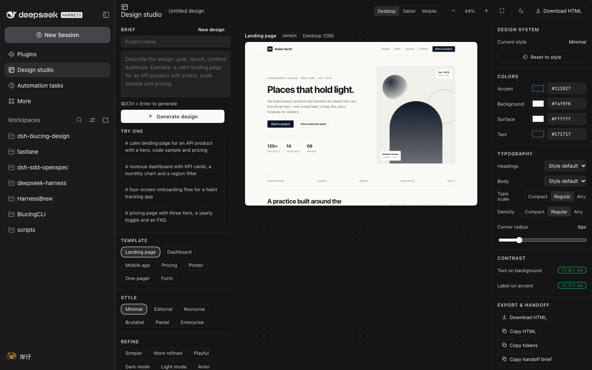
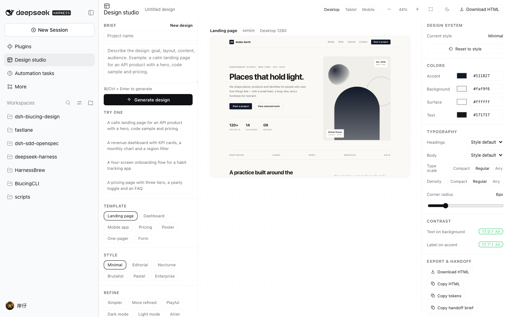
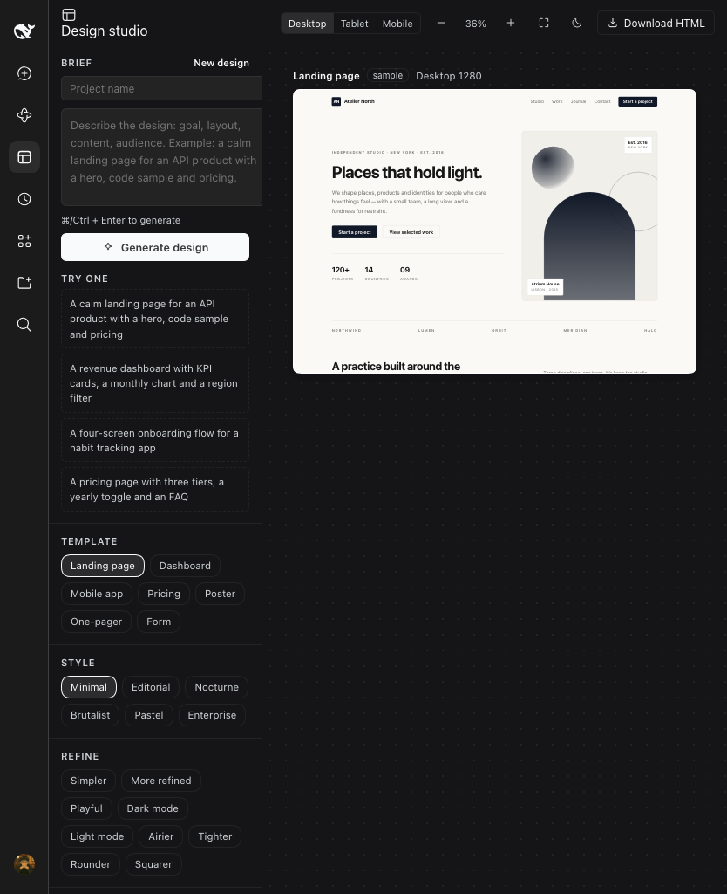
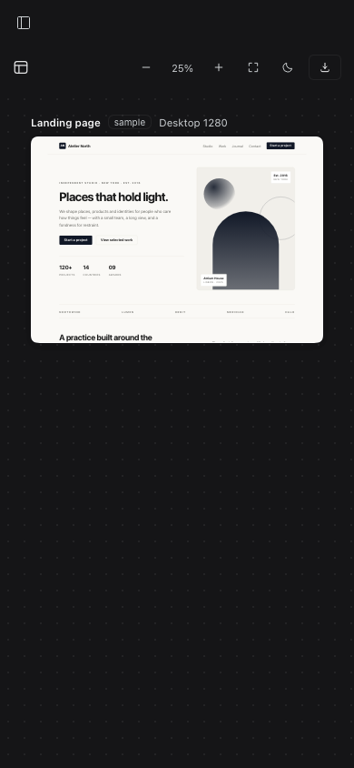
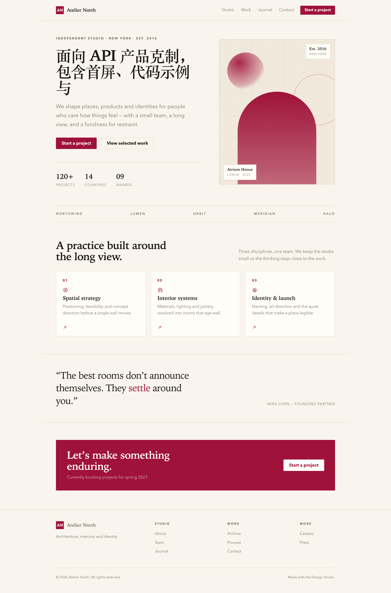
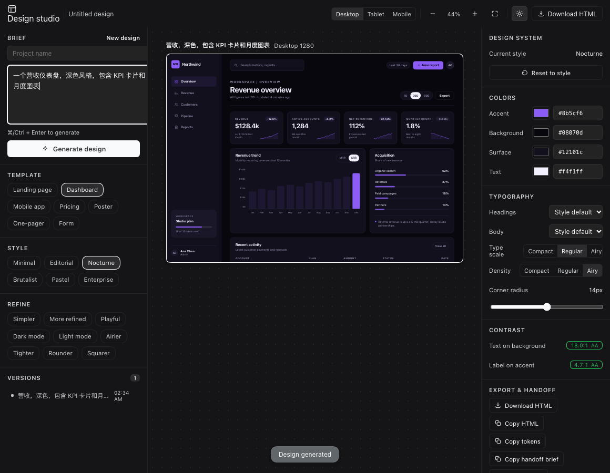
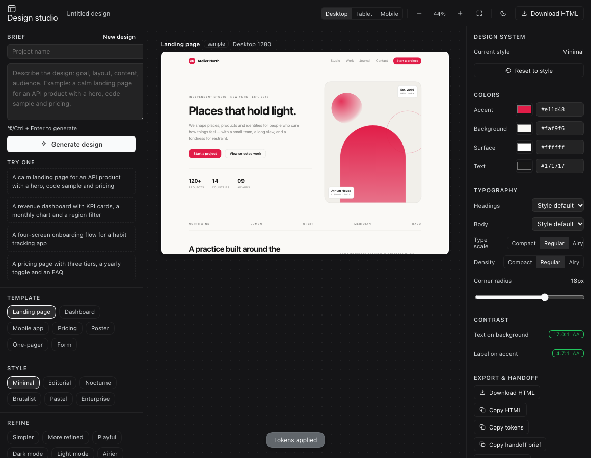
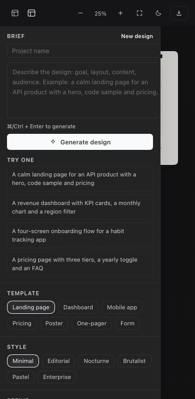
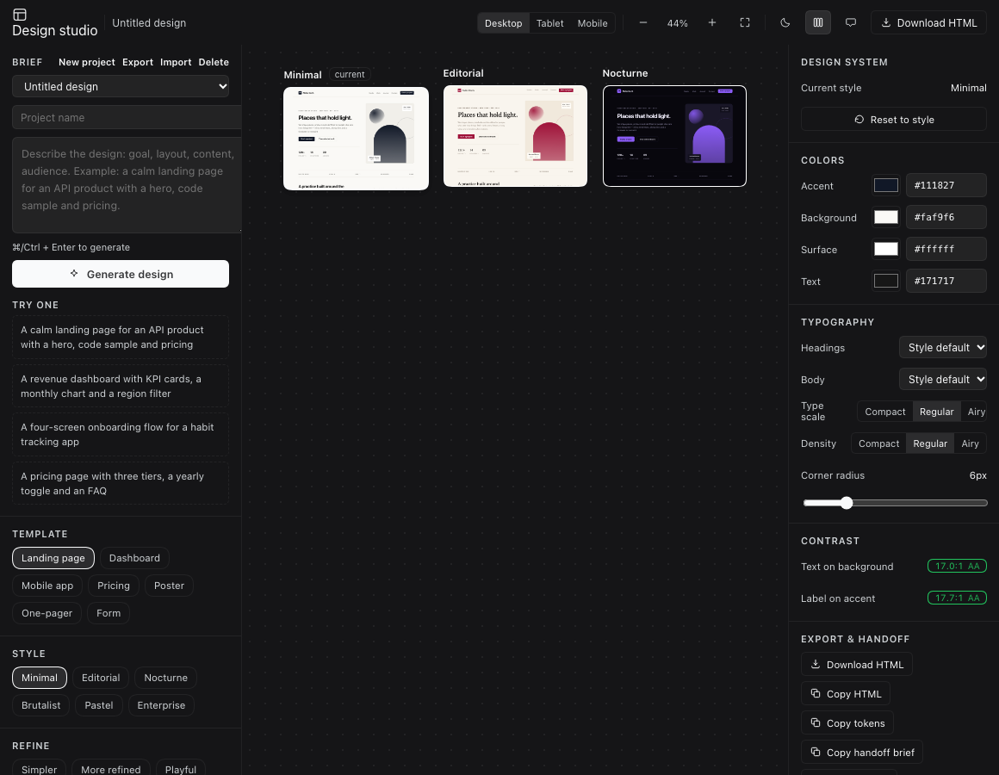
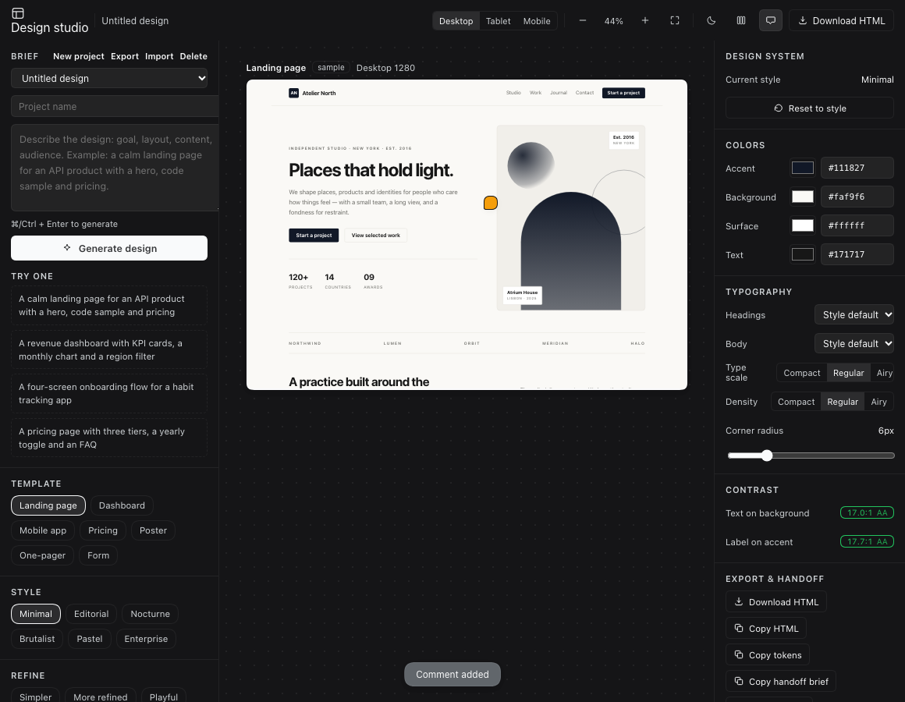

# 视觉核验落地记录（v1.1.0）

> 目标：补上此前“本环境没有浏览器控制能力、无法截图核验”的缺口。
> 结论：**已落地并完成两轮真实截图核验** —— 插件自带 headless Chrome 工具，能截图 + 审计设计工作室面板本身，也能渲染任意自包含设计稿。

## 1. 新增能力

| 工具 | 行为 | 输出 |
|---|---|---|
| `design_verify_ui` | 用 `connection.authenticatedUrl(webApp.getAdvertisedUrl())` 获取带鉴权的 Web GUI 地址 → 打开 `?panel=design-studio` 深链（token 重定向丢失 query 时二次导航）→ 关闭首屏 Preview Notice → 等待面板 → 截图 + 页面内审计 | PNG 路径（可交给 `read_image`）+ 布局/色值/对比度/控制台错误报告 |
| `design_screenshot_html` | 把内联 HTML 或本地 `.html` 在 headless Chrome 中按指定 viewport 渲染（支持 full page） | PNG 路径（可交给 `read_image`） |

实现位于 `plugin/dsh-design-studio/lib/`（`chrome.js` 浏览器发现/启动/清理、`cdp.js` 精简 CDP、`audit.js` 页面内审计表达式、`tools.js` 两个 tool）；
浏览器使用独立临时 profile，截图默认写入工作区 `.design-studio/screenshots/`，不会触碰用户浏览器 cookie。

## 2. 真实截图

### 2.1 设计工作室面板（桌面 1440×900，深色 / 浅色）





审计结果（深色）：面板已挂载；三列 `left 281 / canvas 634 / inspector 245` 均为 848 高；iframe 沙箱存在；无横向溢出；无控制台错误；
文字对比度 **17.45:1**、主按钮 **11.57:1**（浅色为 17.0:1 / 17.7:1），均达到 AA。

### 2.2 窄视口（平板 834 / 手机 390）





容器查询生效：面板宽度 < 980 时隐藏右侧检查器，< 760 时隐藏左侧需求栏、顶栏收起文字，只保留画布。

### 2.3 设计稿本身

`design_screenshot_html` 渲染引擎生成的 Editorial 落地页（1440 宽、full page 1440×2181）：



## 2.4 v1.2：交互脚本、裁剪与面板 UX（本轮新增）

工具升级为「可自动验收」：`design_verify_ui` 支持 `steps`（click / type / wait / screenshot），
默认把截图裁剪到 `.dsx-root`（不再包含左侧工作区/会话名），并输出 `issues[]` + PASS/FAIL，
同时通过 CDP OOPIF target 审计沙箱 artboard 里的设计稿。

真实交互验收一（输入需求 → 生成设计；面板裁剪 1160×900）：



- 步骤：`type .dsx-textarea` → `click .dsx-primary` → `wait 800` → `screenshot`
- 结果：PASS；模板自动切到 Dashboard、风格 Nocturne，`design inside artboard: 1280x2080, overflow no, text contrast 17.03:1`。

真实交互验收二（导入 tokens → 应用；Panel 裁剪）：



- 步骤：`click "Import tokens"` → `type` JSON `{"accent":"#e11d48","radius":18}` → `click "Apply tokens"`
- 结果：PASS；inspector 显示 Accent `#e11d48`、圆角 18px，画布同步更新，对比度仍为 AA。

真实交互验收三（窄窗口抽屉）：



- 390×844 视口下点击顶栏抽屉按钮，需求/模板/风格以覆盖层打开；通过 `steps` 自动截图验证。

另外本轮的隐私修复可直接从截图尺寸确认：旧截图 1440×900（含 DSH 侧栏），新截图 1160×900（仅面板）。

## 2.5 v1.3：多项目、风格对比、画布批注、Agent↔面板项目桥

### 多项目

项目切换器 + 新建/导入/导出/删除；每个项目独立保存需求、模板、风格、tokens、版本、批注：
自动步骤「点击 New project」后审计显示 `2 project(s) in the switcher`。


### 风格对比

顶栏「对比风格」把当前模板按 3 套风格并排渲染，点击任一画板应用其风格：
审计显示 `3 compare artboards`，截图可见 Minimal / Editorial / Nocturne 三个画板与 current 标记。



### 画布批注

批注模式下点击画板任意位置（`clickAt` 步骤）、输入文字、Add note，批注钉按百分比定位并在缩放后保持位置；
审计显示 `1 comment pins`，批注同时进入「复制交付说明」。



### Agent ↔ 面板项目桥

新增工具 `design_projects`（list / read / write）：Agent 把项目 JSON 写入
`<workspace>/.design-studio/projects/`，用户在面板「导入」打开；面板导出的 JSON 也可被 Agent 读取。
纯文件交换，不监听端口。Host 自测覆盖写入/列表/读取往返与目录外路径拒绝。

## 3. 核验中发现并修复的问题

| 问题 | 证据 | 修复 |
|---|---|---|
| **右侧「设计系统」列被渲染到 `.dsx-body` 之外**：三列 flex 布局只剩两列，检查器浮在左侧栏下方并与内容重叠 | `screenshots/design-studio-desktop-before-layout-fix.png` | 修正 canvas 结束后多出的一个右括号（`src/client.js`），补回检查器；新增“三列必须是 `.dsx-body` 子元素”的回归断言（`src/test-built.mjs`） |
| 画板初始 72% 超出画布、居中导致左侧被裁切 | 修复前面板截图中画板标签被裁 | 画布改为 `flex-start` + 画板 `margin:0 auto`；首次挂载按画布宽度自动 fit（不覆盖用户手动 zoom） |
| 窄窗口顶栏换行、控件挤压、项目名断行 | 390 宽初版截图 | 顶栏 `nowrap + overflow-x:auto`；容器查询在 <900 隐藏项目名/分隔线，<640 隐藏品牌文字与设备分段 |
| 深色主题主按钮白底白字（审计 F-02） | 修复前不可读 | 使用 `--dsw-alias-label-primary-inverted`；本次截图确认深色 `#f9fafb` 底 + `#353638` 字（11.57:1✓），浅色 `#111827` 底 + `#fff` 字（17.7:1✓） |
| 首屏 Preview Notice 遮挡、token 重定向丢失 `?panel=` query | 第一轮截图与报告 `deep link kept panel param: no` | 工具自动关闭 Continue 弹窗；检测 query 丢失后带 cookie 二次导航到 `?panel=design-studio`，仍失败则点击侧栏「Design studio」条目兜底 |

## 4. 复现方式

在本会话中（插件安装后）：

```text
design_verify_ui({ device: "desktop", theme: "light" })
design_verify_ui({ device: "mobile" })
design_verify_ui({ device: "desktop", steps: [
  { action: "type", selector: ".dsx-textarea", text: "一个营收仪表盘，深色风格" },
  { action: "click", selector: ".dsx-primary" },
  { action: "wait", ms: 800 },
  { action: "screenshot", label: "after-generate" }
]})
design_screenshot_html({ file_path: ".design-studio/probe/editorial-landing.html", width: 1440, full_page: true })
```

工具报告会给出 PNG 路径，随后用内置 `read_image` 读取即可让模型看到界面。

自动化测试（不依赖 DSH 运行）：

```bash
cd plugin/dsh-design-studio
node src/test-host.mjs     # 9 checks，含真实 headless Chrome 截图 + PNG 尺寸校验
node src/test-built.mjs    # 15 checks，含三列布局回归
node src/test-engine.mjs   # 14 checks
```

## 5. 限制

- 截取的是 **Web GUI**（浏览器表面），不是 Electron 原生窗口；字体渲染/窗口控件可能与桌面壳略有差异。真实窗口级截图需要 macOS Computer Use bundle（CUA，另需系统权限）。
- 依赖本机 Chrome / Chromium；可用 `DSH_DESIGN_CHROME` 指定路径，缺失时工具给出明确错误。
- Chrome 自身沙箱不可用的容器/CI 环境会自动回退 `--no-sandbox` 重试（独立临时 profile）。
- 窄窗口（<760）会隐藏左侧编辑栏，这是刻意的响应式取舍，不是渲染缺陷。
- 仓库中的截图是本次核验证据，运行期截图仍写入被忽略的 `.design-studio/screenshots/`。
